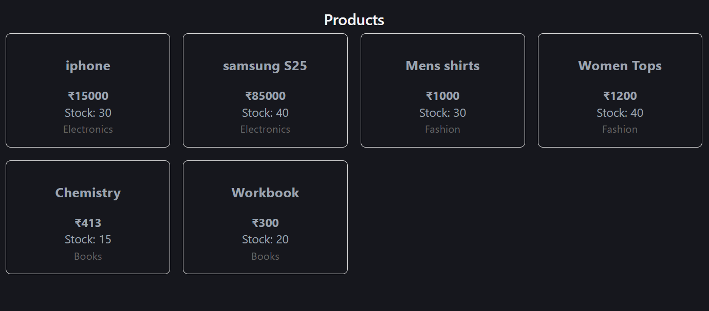
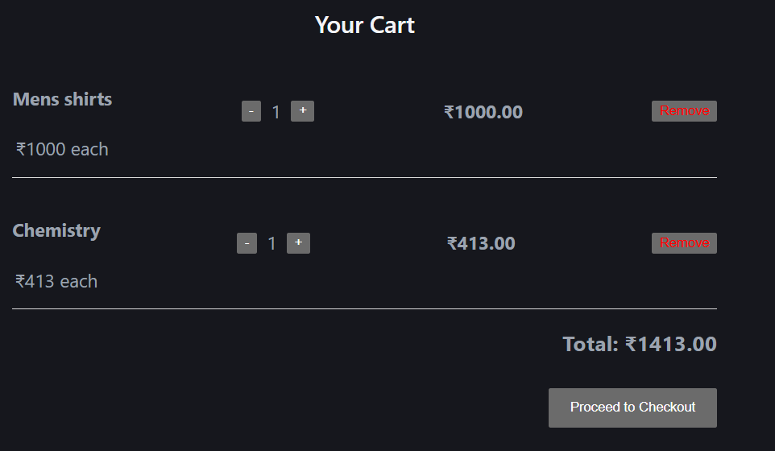
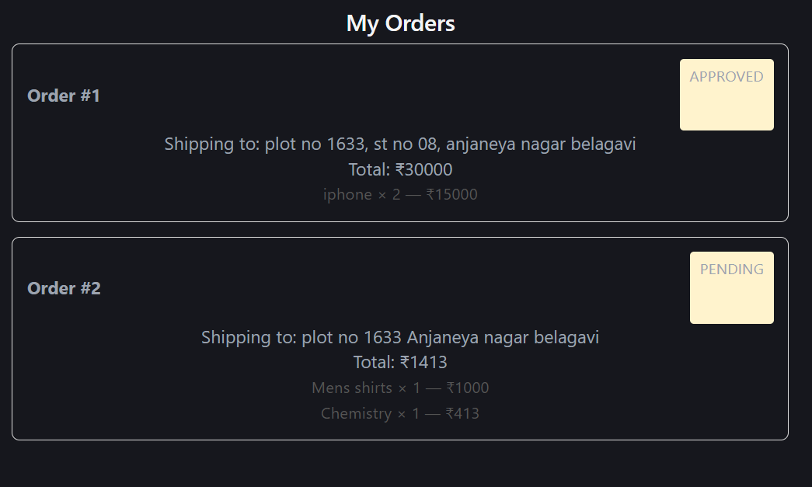
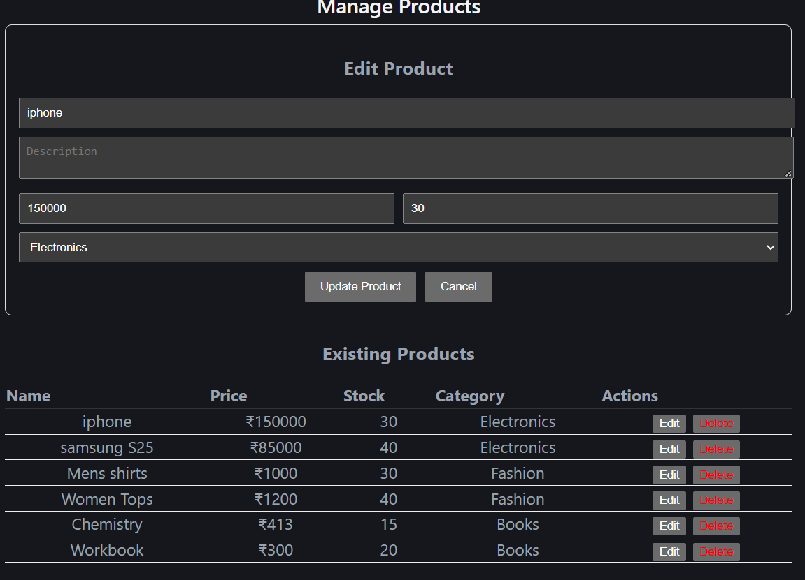

# Sales Savvy

A full-stack e-commerce application for small and medium businesses. Customers browse products, use a cart, place orders and track them. Admins manage products, categories and order statuses.

This repository holds the Docker setup that runs the whole application with one command. The code lives in two other repositories:

- Backend: https://github.com/Babu-Shigihalli/sales-savvy-backend
- Frontend: https://github.com/Babu-Shigihalli/sales-savvy-frontend

## Features

- Customer registration and login with JWT authentication
- Two roles, ADMIN and CUSTOMER, enforced on the server
- Product and category catalog with admin-only create, edit and delete
- Shopping cart tied to the logged-in user
- Checkout that turns the cart into an order, saving the price at purchase time
- Order tracking: PENDING, APPROVED, SHIPPED, DELIVERED, CANCELLED
- Admin dashboard for products, categories and orders
- Razorpay payment integration with signature verification (needs your own test keys)
- Clean JSON error responses

## Tech stack

| Layer | Technology |
|---|---|
| Frontend | React (Vite), React Router, Axios |
| Backend | Java, Spring Boot, Spring Security, Spring Data JPA |
| Database | MySQL 8 |
| Auth | JWT, BCrypt password hashing |
| Payments | Razorpay |
| DevOps | Docker, Docker Compose, nginx |

## Run it with Docker

You need Docker Desktop installed and running.

1. Clone the three repositories side by side:

        git clone https://github.com/Babu-Shigihalli/sales_savvy_docker.git
        cd sales_savvy_docker
        git clone https://github.com/Babu-Shigihalli/sales-savvy-backend.git
        git clone https://github.com/Babu-Shigihalli/sales-savvy-frontend.git

2. Start everything:

        docker compose up --build

3. Open http://localhost:5173

The first start takes a few minutes while the images build. The backend runs on port 8080 and MySQL is exposed on port 3307.

## Create the first admin

New accounts are customers. To make the first admin:

1. Register an account on the website.
2. Promote it in the database:

        docker compose exec mysql mysql -uroot -prootpass sales_savvy -e "UPDATE users SET role_id = 1 WHERE email = 'your-email@example.com';"

3. Log out and log in again. An Admin link appears in the top bar.

Once you are an admin, you can create more admins with POST /api/auth/register-admin and your admin token.

## Useful commands

    docker compose up -d         # start in the background
    docker compose down          # stop everything, keep the data
    docker compose up --build    # rebuild after changing code
    docker compose down -v       # stop and delete the database data

## Payments

The Razorpay code is complete. To test payments, add your Razorpay test keys as the environment variables RAZORPAY_KEY_ID and RAZORPAY_KEY_SECRET in the backend section of docker-compose.yml.

## Notes

The database password in docker-compose.yml is for local development only. Change it before deploying anywhere public.

## Screenshots

### Storefront

### Cart

### Admin: manage orders

### Admin: manage products

