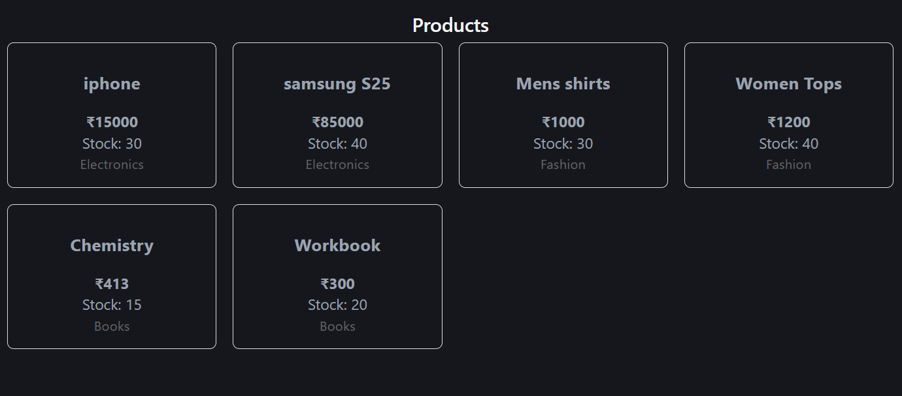
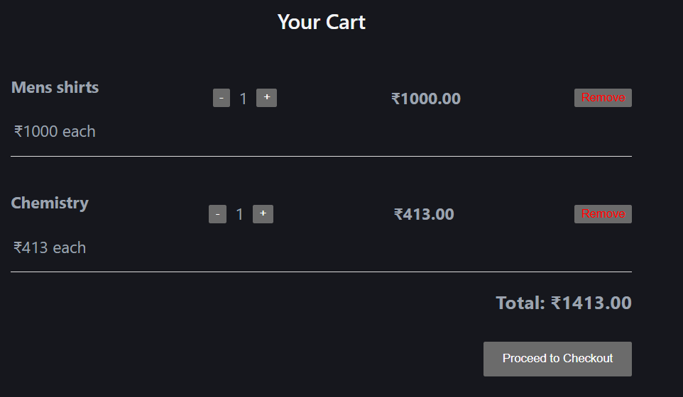
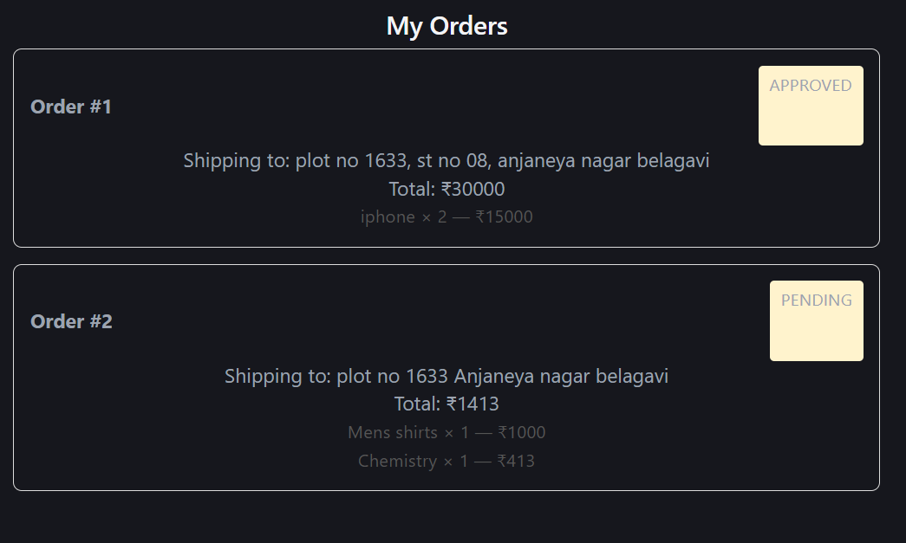
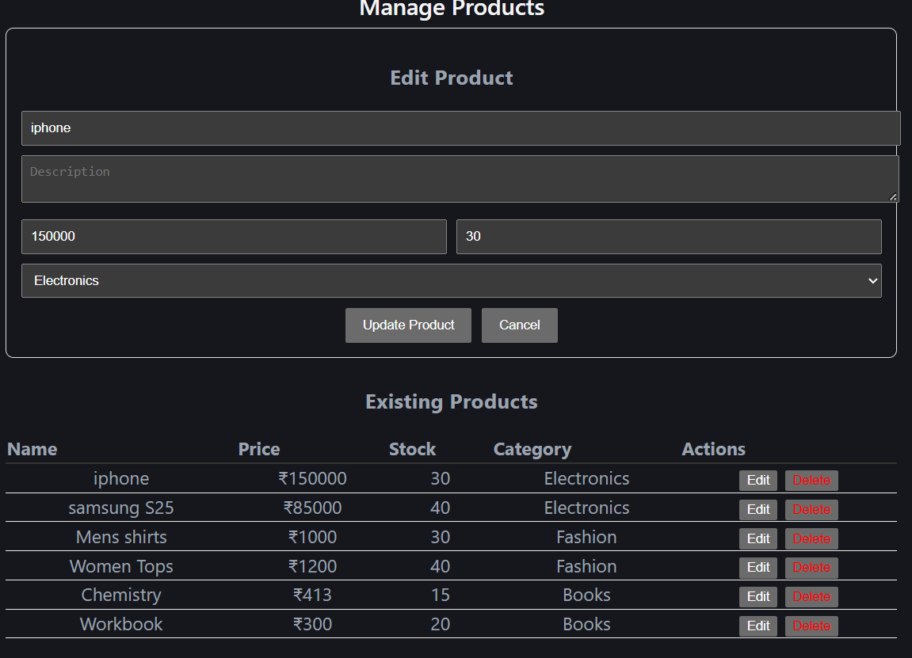

# Sales Savvy

A full-stack e-commerce application for small and medium businesses. Customers browse products, use a cart, place orders, pay online and track their orders. Admins manage products, categories and order statuses.

This repository holds the Docker setup that runs the whole application with one command. The code lives in two other repositories:

- Backend: https://github.com/Babu-Shigihalli/sales-savvy-backend
- Frontend: https://github.com/Babu-Shigihalli/sales-savvy-frontend

## Features

Customers

- Register and log in with JWT authentication
- Browse products with search, category menu and sorting
- Shopping cart tied to the logged-in user
- Checkout that reserves stock, then opens the Razorpay payment popup
- My Orders with status tracking, Pay now for unpaid orders and cancellation of unpaid orders

Admins

- Dashboard for products, categories and orders
- Create, edit and delete products with image upload
- Update order statuses (PENDING, APPROVED, SHIPPED, DELIVERED, CANCELLED)
- Optional AI button that drafts a product description (needs an API key)

Platform

- Two roles, ADMIN and CUSTOMER, enforced on the server
- Stock is reduced when an order is placed and returned when an order is cancelled
- The price is saved on each order item at purchase time
- Customers can only read, pay for or cancel their own orders
- Payment signatures are verified on the server before an order is approved
- Clean JSON error responses

## Screenshots

### Storefront

### Cart

### Admin: manage orders

### Admin: manage products

## Tech stack

| Layer | Technology |
|---|---|
| Frontend | React (Vite), React Router, Axios, Bootstrap |
| Backend | Java, Spring Boot, Spring Security, Spring Data JPA |
| Database | MySQL 8 |
| Auth | JWT, BCrypt password hashing |
| Payments | Razorpay (test mode) |
| Testing | JUnit 5, Mockito |
| DevOps | Docker, Docker Compose, nginx, GitHub Actions |

## Run it with Docker

You need Docker Desktop installed and running.

1. Clone the three repositories side by side:

        git clone https://github.com/Babu-Shigihalli/sales_savvy_docker.git
        cd sales_savvy_docker
        git clone https://github.com/Babu-Shigihalli/sales-savvy-backend.git
        git clone https://github.com/Babu-Shigihalli/sales-savvy-frontend.git

2. Start everything:

        docker compose up --build

3. Open http://localhost:5173

The first start takes a few minutes while the images build. The backend runs on port 8080 and MySQL is exposed on port 3307. Uploaded product images are kept in a Docker volume.

## Create the first admin

New accounts are customers. To make the first admin:

1. Register an account on the website.
2. Promote it in the database:

        docker compose exec mysql mysql -uroot -prootpass sales_savvy -e "UPDATE users SET role_id = 1 WHERE email = 'your-email@example.com';"

3. Log out and log in again. An Admin link appears in the top bar.

Once you are an admin, you can create more admins with POST /api/auth/register-admin and your admin token.

## Payments (Razorpay test mode)

Checkout opens the Razorpay popup after an order is placed. The backend creates the Razorpay order and verifies the payment signature before marking the order APPROVED. If the popup is closed, the customer can use Pay now on My Orders.

To try it, create a Razorpay account, generate test keys and put them in a file named .env next to docker-compose.yml:

    RAZORPAY_KEY_ID=your_test_key_id
    RAZORPAY_KEY_SECRET=your_test_key_secret

Then run docker compose up -d. In the popup, pick Netbanking and click Success on the mock page, or use a Razorpay test card. UPI QR and UPI intent work only in live mode. Never commit the .env file.

## AI product descriptions (optional)

Admins get a Generate with AI button on the product form. It needs an API key, which you add to the same .env file:

    ANTHROPIC_API_KEY=your_key

Without a key, the button shows a message that AI is not configured, and the rest of the site works normally.

## Tests and CI

The backend has unit tests for the order and stock logic, using Mockito, so they need no database:

    mvn test

GitHub Actions builds the backend (with tests) and the frontend on every push.

## Useful commands

    docker compose up -d         # start in the background
    docker compose down          # stop everything, keep the data
    docker compose up --build    # rebuild after changing code
    docker compose down -v       # stop and delete the database and uploads

## Notes

The database password in docker-compose.yml is for local development only. Change it before deploying anywhere public.
